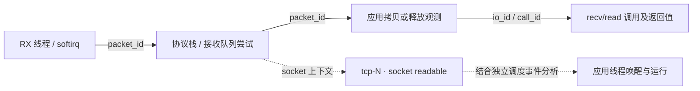

# Perfetto 收发链路分析

默认精简模式保留关键节点，`--trace-tags` 极简模式保留 socket 创建、应用调用与关键收发包；
`--trace-detail` 展开 `trace.yaml` 中已注册且设备可挂载的路径探针。
详细模式表示全部受支持的观测点，不表示任意内核函数的完整调用栈；
内联函数、厂商驱动私有路径及硬件卸载阶段可能没有探针。

## 抓取

极简模式使用 `--trace-tags`，与 `--trace-detail`、`--connect-diagnostics` 互斥。
必要的 socket 归属、skb 生命周期及调用关联探针继续采集。packet 参数保留
`socket_id`、`packet_id`、`skb_id`、`flow_id`、`io_id`、`call_id`、IP ID（可用时）、
地址、端口、TCP/ICMP/DNS 字段和执行上下文；缺失的证据仍保留未知。
socket 创建的起止时间作为 `socket allocation` 显示，参数含同一 `socket_id`。
不显示关联箭头、socket 生命周期长条、协议层 I/O 切片或 socket packet 镜像。

```sh
./anettrace --capture-trace --trace-tags --uid 10187 --duration 20 \
  --output /data/local/tmp/network-tags.pftrace

python3 tools/capture_android_trace.py --package com.example.app --trace-tags \
  --duration 20 --out output/app-tags

# 已有 JSONL 可以重新生成极简展示；源文件内容保留
python3 tools/anettrace_to_perfetto.py events.jsonl network-tags.pftrace --trace-tags
```

直接采集的 JSONL 会记录显示模式，后续转换自动采用极简展示。
以下默认精简/详细模式的连线和概览说明，适用于未启用 `--trace-tags` 的轨迹。

在设备 root shell 中运行，将 UID 替换为目标应用的实际 UID：

```sh
# 默认：精简网络事件和系统调度
./anettrace --capture-trace --uid 10187 --trace-profile sched \
  --duration 20 --output /data/local/tmp/network.pftrace

# 详细：展开全部已注册且可用的网络探针
./anettrace --capture-trace --trace-detail --uid 10187 --trace-profile sched \
  --duration 20 --output /data/local/tmp/network-detail.pftrace
```

| 能力 | 精简模式（默认） | 详细模式（`--trace-detail`） |
| --- | --- | --- |
| Socket 创建、状态、关闭及流关联 | 显示 | 显示 |
| 应用收发系统调用、协议层 send/recv | 显示 | 显示 |
| SYN/SYN-ACK、FIN/RST、关键收发包事件 | 显示 | 显示原始函数阶段 |
| 接收队列尝试、socket 数据就绪、数据拷贝/释放关联 | 显示 | 显示 |
| NAPI/GRO、CPU backlog、IP、路由、netfilter、qdisc 等中间阶段 | 隐藏，保留必要关联采集 | 展开可用探针 |
| `socket_id / flow_id / packet_id / io_id / call_id` | 保留 | 保留 |

`--trace-profile full/sched` 只决定系统 Perfetto 数据源，不决定网络显示模式。
使用自定义 `--perfetto-config` 时，需要自行包含 `sched/sched_switch`、
`sched/sched_waking` 和进程信息数据源，才能同时分析调度。
`--system-trace-only` 不采集本文的 Anettrace 网络事件。
`--traffic` 可以附加显示流量统计，不是链路关联的前提。

尽量在创建 socket、建立连接之前开始抓取。`--uid` 过滤在 RX 早期尚未建立
socket 归属时可能漏掉事件；必要时短时间移除 UID/PID 过滤并使用 `--force`，
再按地址和关联 ID 筛选。`--force` 不会取消命令中仍保留的过滤条件。
`--tid`（兼容旧 `--pid`）是精确线程 ID，不包含该进程的所有线程。
主机工具支持 `--package` 解析应用 UID；直接唤醒上下文、早期 RX 补全及队列状态
见[应用收发链路采集](packet-flow-foundations.md)。

详细模式会挂载更多探针，事件量和运行开销也会增加。缺失探针、用户排除项、
丢失事件或环形窗口截断都可能使链路不完整；不要把缺失节点理解为该阶段没有执行。

## 在界面中串联

1. 搜索 `tcp-1`、`udp-1` 等流标签，或先搜索对端地址/端口，找到目标流。
   包名称同时包含流标签和阶段，例如 `tcp-1 · TCP packet receive`；
   详细模式显示 `tcp-1 · tcp_v4_rcv`。标签只在当前 trace 中有效。
2. 通过 `socket associated · tcp-N` 的 `socket_id` 回到 socket 创建和生命周期。
   Socket 创建时通常还没有对端，后续关联事件提供桥接；不会猜测创建时的 flow。
3. 点击某个包，复制完整 `packet_id` 搜索，或查看该包的 flow 连线。
   同一连接的其他包不会仅因 `flow_id` 相同而被串成一条包级因果线。
4. 在 `packet submitted by call`、`packet copy to application` 或
   `packet released by receive` 中取得 `io_id` 和 `call_id`，继续定位协议层
   send/recv 和线程下的 `Network syscalls`。`socket I/O · tcp-N` 连接 socket
   与本次 I/O，`recvfrom returned · tcp-N` 等独立返回节点标记调用完成。
5. 检查调用的 `result`、`bytes`、`error`、`incomplete`。一个调用可能涉及多个包，
   一个 TCP 包也可能承载多个写调用的数据，不应按一包一次调用理解。

| 字段 | 含义 |
| --- | --- |
| `flow_tag` / `flow_id` | 当前 trace 内的一条连接或 UDP 会话 |
| `socket_id` | Socket 实例，区分地址复用后的不同代次 |
| `packet_id` | 被观测到的 skb 实例，区分分配代次 |
| `io_id` | 一次协议层 sendmsg/recvmsg 调用 |
| `call_id` | 一次应用网络系统调用 |
| `handoff_id` | 一次 socket 数据就绪回调观测 |

参数均作为字符串存储，完整 ID 可以直接粘贴到顶部搜索框，
使用 Enter / Shift+Enter 在匹配事件之间跳转。顶部搜索是子串匹配。
搜索框不是表达式解析器：`dport=443` 不等同于字段过滤。
精确条件使用 `EXTRACT_ARG(arg_set_id, 'debug.dport') = '443'`；
数值比较前使用 `CAST(... AS INT)`。收包时 `dport` 通常是本地端口。

## 一次查询展开链路

把 [network_chain.sql](../tools/perfetto_sql/network_chain.sql) 粘贴到 Perfetto
SQL 页，修改开头 `selection` 中的两个字符串，例如：

```sql
selection AS (SELECT 'flow_tag' AS seed_kind, 'tcp-1' AS seed_id),
```

可选择 `flow_tag`、`flow_id`、`socket_id`、`packet_id`、`io_id`、`call_id` 或
`handoff_id`。流条件用于查看整条流；socket 条件可能包含同一 UDP socket 的多个会话。
包和调用条件只沿已观测到的
包/调用 ID 扩展，再附带 socket 创建和流上下文，不把同连接的其他包都当成
这个包的因果后继。结果保留 `id/ts/dur/track_id`，可以定位到原始事件；
`relation` 区分直接关联与仅用于理解的 socket/flow 上下文。

## 收包方向的证据



网络事件落在实际执行线程下，关联不依赖高通或 MTK 的线程命名。
因此高通 `dp_rx_thread` 或 MTK 的接收线程执行已挂载的通用协议栈
探针时，事件会出现在该线程轨道上；切换到 `ksoftirqd` 或应用线程后，也保留
实际上下文。`owner_tid` 是 socket 归属信息，不等于实际读取者或被唤醒线程。
softirq 可能借用 idle 或其他任务的执行上下文；`tid=0` 时结合 `cpu` 区分 CPU，
不要仅凭线程名将网络处理归属到那个应用。

`tcp-N · socket readable` 表示实际进入 `sock_def_readable` 回调。
它能通过 socket/流查询与其他阶段一起显示，但没有直接标识触发它的某个包或
某次线程唤醒。自定义 `sk_data_ready`、无需调用该回调的路径以及已经在运行的
应用线程不会强行补出一个唤醒事件。`sched_waking` 的唤醒来源可通过系统 trace
交叉检查；时间接近不能替代包级证据。

`copy_attempt` 是拷贝入口观测，`receive_release` 是接收缓冲释放观测，
队列事件是入队尝试。它们都不单独证明应用成功读到对应字节，结果以调用返回为准。
`MSG_PEEK`、截断读取、批量收发、TCP 合并及分段需要结合 offset、长度和返回值解释。
`submission_context` / `stored_submission_context` 证明该 skb 曾在一次发送调用中被观测，
不代表整个包的字节只来自这次 send。TCP 向已有 skb 追加数据时可能没有新的提交探针；
精简模式也可能只保留某次调用的提交关联，而没有该 skb 的后续可见包阶段。
`io_multiple` 只在实际观测到多个提交来源时置位，不能用 false 证明来源唯一。
GRO/GSO、clone、分片、重传及缓冲 head 替换可能产生不同 skb 实例；
当前不会把不同实例伪装成同一个线上物理包。

使用新版本重新抓取才能获得新增采集点。旧 JSONL 可以重新转换以更新显示方式，
但转换器无法补回原始数据中不存在的采集证据。
